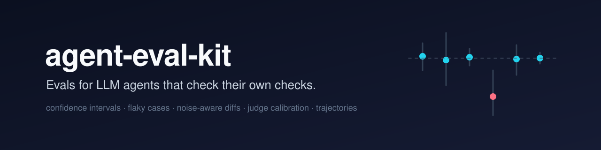
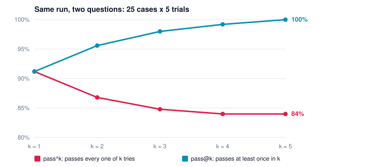

<p align="center">
  
</p>

<p align="center">
  <a href="https://github.com/robsavage619/agent-eval-kit/actions/workflows/ci.yml"></a>
  
  
  <a href="LICENSE"></a>
</p>

A golden-set eval harness for LLM agents that tells you how much to trust its own numbers.

Most eval tools give you a pass rate. With 25 cases and a model that samples, that number moves several points between identical runs, so "91% to 86%" might be a regression or might be Tuesday. This kit runs your cases, scores them, and then does the part that usually gets skipped: it puts an interval on the result, finds the cases that pass only some of the time, tells you whether a drop is bigger than chance, says how small a change your eval could even detect, and checks your LLM judge against human labels before you let it gate a merge.

It is a library and a CLI, about 2,000 lines of Python, with pydantic as the only runtime dependency. It runs in CI next to your tests. There is no server and no dashboard.

```bash
pip install "agent-eval-kit[llm] @ git+https://github.com/robsavage619/agent-eval-kit"
```

## What it tells you that a pass rate doesn't

Everything below is real output from the demo in [`examples/support_agent`](examples/support_agent): a small simulated support agent that triages messages and calls tools. It needs no API key, so you can reproduce every number here.

### 1. How sure you can be, and how reliable each case is

```bash
aek run examples/support_agent/evals.py --repeats 5
```

| Metric | Value |
|:---|:---|
| Cases | 25 x 5 trials |
| Pass rate | **91.2%** (95% CI 82% to 98%) |
| Passed every trial | 84.0% |
| Flaky cases | 4 |

Running each case several times separates "can pass" from "reliably passes". The kit reports both ends of that curve using the unbiased estimators from tau-bench and Chen et al. (2021): **pass^k** is the chance a case passes k times in a row, which is what a user who comes back tomorrow experiences, and **pass@k** is the chance it passes at least once.

<p align="center"></p>

A 91% agent that is 84% reliable has 4 flaky cases. The report lists them, and the per-tag table shows where they live: here, every one of them is an ambiguous message.

### 2. Whether a change actually broke something

The demo's `v2` agent is a "small prompt change" with two bugs: refunds under $50 skip the order lookup, and any message mentioning a refund gets routed to refunds, even when the customer asked to cancel.

```bash
aek compare examples/support_agent/baseline.json v2.json
```

> ❌ **Regression.** More cases broke than chance explains.
>
> 🚨 **Critical case regressed:** `cancel_not_refund`
>
> Cases regressed: **6**, improved: **0**, degraded: **0**, flaky in baseline (set aside): **4**. Exact McNemar p = 0.031 (alpha 0.05).
>
> **What this comparison can see.** With 25 paired cases, a paired test would catch a true change of about **13%** in mean score 80% of the time. Separately, the exact test cannot call anything significant until at least **6** cases flip the same way (24% of these cases).

A pass-rate diff would blur together several different things:

- **Cases already flaky in the baseline are set aside.** If a case flipped between identical trials before your change, its movement now says nothing about the change. A case that was solid and *starts* flaking is the opposite: it counts against you.
- **The verdict is a paired test.** Exact McNemar on the cases that flipped, so 3 flips out of 25 reads as noise (p = 0.25) and 6 one-directional flips reads as a regression (p = 0.031).
- **Critical cases fail on their own.** Tag a case `critical` and any drop in its pass rate blocks the gate, significant or not, even 3/3 to 2/3. Refunding an order the customer asked to cancel should never wait for a p-value.
- **Errors are not regressions.** A trial where the agent or judge raised (a timeout, a 529) is kept out of every statistic and reported on its own, so an API outage cannot pass for a regression. `aek run` fails on errors unless you allow some with `--max-errors`.

The last block of the report is the one people skip. A "no detectable change" from 25 cases only rules out large changes. `aek power` tells you how many cases the change you care about would take, and which assumption drives the answer:

```
$ aek power examples/support_agent/baseline.json --delta 0.05 --against v2.json
Paired test (Miller 2024, alpha 0.05, 80% power): about 167 cases to detect a 5% change; the current 25 cases detect about 13%.
Exact test floor: at least 6 cases must flip the same way, so a 5% change in pass rate needs at least 120 cases.

Plan for about 167 cases.
```

### 3. Whether your judge deserves your trust

An LLM judge is a model grading a model. Before its pass rate means anything, you need to know how often it agrees with a person, and in particular how often it **passes output a person would fail**. That number is what lets bad answers through CI.

The demo calibrates the judge people usually write first, a keyword check, against 40 hand-labeled replies:

```bash
aek calibrate examples/support_agent/evals.py:reply_suite examples/support_agent/labels.jsonl
```

> ❌ **Do not trust.** The judge disagrees with people too often.

| | Human: pass | Human: fail |
|:---|---:|---:|
| **Judge: pass** | 20 | **8** |
| **Judge: fail** | 4 | 8 |

Agreement is 70%, which sounds fine. Cohen's kappa is 0.35, and the false-pass rate is **50%**: half the replies a person rejected got through. Every one of them mentions a refund without giving one: they refuse it, stall, ask for a password, or answer a different question. The report lists each disagreement next to the labeler's note, so you can see what to fix.

### 4. Whether the agent got there the right way

An agent can return the right answer for the wrong reason. `TrajectoryJudge` checks the tool calls an agent made against the case:

```jsonl
{"id": "refund_large_screen",
 "input": {"message": "Refund order E5501, it was $899 and the screen is cracked"},
 "expected": {"intent": "refund",
              "trajectory": {"required": ["lookup_order", "escalate_to_human"],
                             "forbidden": ["issue_refund"]}},
 "tags": ["refund", "critical"]}
```

Combine it with an answer check and a case needs both the right result and the right path: `AllOf([ExactMatchJudge(keys=["intent"]), TrajectoryJudge(max_repeats=2)])`. `extract_tool_calls()` builds the trajectory from LangGraph / LangChain messages, Anthropic `tool_use` blocks, or OpenAI tool calls.

## Quickstart

**1. Write a golden set.** One JSON object per line: `input` goes to your agent, `expected` goes to the judge, `tags` let you slice results and mark cases `critical`.

```jsonl
{"id": "refund_request", "input": {"message": "I want my money back for A1001"}, "expected": {"intent": "refund"}, "tags": ["refund", "critical"]}
{"id": "where_is_it", "input": {"message": "Where is order B2207?"}, "expected": {"intent": "order_status"}}
```

**2. Describe the suite.** Your agent is any `async (dict) -> dict` function, such as a compiled LangGraph graph's `ainvoke` or a direct SDK call.

```python
# evals/evals.py
from agent_eval_kit import GoldenSet, Suite
from agent_eval_kit.judges import ExactMatchJudge

from my_app import triage_agent

suite = Suite(
    name="triage",
    golden_set=GoldenSet.from_jsonl("evals/golden_set.jsonl"),
    agent=triage_agent,
    judge=ExactMatchJudge(keys=["intent"]),
    repeats=3,
)
```

**3. Run it, save a baseline, and compare future runs to it.**

```bash
aek run evals/evals.py --out evals/baseline.json   # commit this file
aek run evals/evals.py --out current.json
aek compare evals/baseline.json current.json       # exit 1 on a real regression
```

The same things are available from Python: `run_evals`, `compare_runs`, `calibrate_judge`, and the reporters.

## In CI

The repo is also a GitHub Action. It runs the suite, compares it to your committed baseline, writes the report to the job summary, and keeps one up-to-date comment on the pull request.

```yaml
name: Evals
on: pull_request
permissions:
  contents: read
  pull-requests: write
jobs:
  evals:
    runs-on: ubuntu-latest
    steps:
      - uses: actions/checkout@v4
      - uses: robsavage619/agent-eval-kit@main
        with:
          suite: evals/evals.py
          baseline: evals/baseline.json
        env:
          ANTHROPIC_API_KEY: ${{ secrets.ANTHROPIC_API_KEY }}
```

The job fails when `aek compare` finds a regression or a critical case gets worse, when trials error, or when you set `min-pass-rate` and the run falls below it. The comment step never decides the job (on a fork PR the token is read-only), and every run is uploaded as the `agent-eval-kit-run` artifact, which is also how you get your first baseline. Set `gate-on: lower` to gate on the lower end of the confidence interval instead of the point estimate, or `strict: "true"` to fail on any regressed case. This repo runs its own demo through the Action on every pull request ([`.github/workflows/evals.yml`](.github/workflows/evals.yml)).

## Reference

### Judges

| Judge | Passes when | Use it for |
|:---|:---|:---|
| `ExactMatchJudge(keys)` | listed fields equal the expected values | labels, routing, structured fields |
| `NumericToleranceJudge(keys, rel_tol, abs_tol)` | numbers are within tolerance | costs, metrics, forecasts |
| `TrajectoryJudge(order, args, arg_overrides, max_steps, max_repeats)` | tool calls match the expectation | agents, tool use |
| `LLMJudge(criteria, threshold, steps)` | Claude's 0-1 score is at least `threshold` | free text, after calibrating it |
| `AllOf([...])`, `AnyOf([...])`, `Not(judge)` | all / any / none pass | combining checks |
| `Weighted([(judge, w), ...], threshold)` | weighted score clears `threshold`; weight 0 means observe only | promptfoo-style scoring |

Use the cheapest judge that can tell right from wrong. `LLMJudge` computes pass/fail from the score in code rather than trusting a boolean from the model, takes fixed `steps` so it grades every case the same way, and raises an explicit error on an unreadable reply. The run records that as an error on the case, outside the statistics, instead of quietly scoring it 0.

**Trajectory modes** follow LangChain's agentevals where they overlap: `in_order` (reference calls in order, extras allowed), `exact` ("strict"), `any_order` ("superset"), `unordered`, and `subset`. Argument checks default to "the reference args must match"; `arg_overrides` sets a rule per tool: `"ignore"`, `"exact"`, a list of keys, or a function.

### CLI

| Command | Does | Exit 1 when |
|:---|:---|:---|
| `aek run SUITE [--repeats N] [--tag T] [--out run.json] [--markdown] [--junit] [--min-pass-rate X] [--gate-on point\|lower] [--max-errors N]` | runs the suite and writes reports | pass rate (or its lower bound) is below the floor, or too many trials errored |
| `aek compare BASE CURRENT [--alpha] [--strict] [--markdown] [--json]` | noise-aware comparison | regression detected, or a critical case got worse |
| `aek calibrate SUITE LABELS [--require trust\|use_with_care]` | scores the suite's judge against human labels | verdict is worse than `--require` |
| `aek power RUN [--delta 0.05] [--trials K] [--against RUN2 \| --diff-sd S]` | cases needed to detect a change | never |
| `aek report RUN` | renders a saved run | never |

Every command exits 2, with a one-line message, when it is used wrongly (a missing file, a suite that does not load, a tag that matches no cases), so CI can tell "the gate failed" from "the eval never ran".

### What a run file records

`run.json` keeps every trial plus the run's spec: a fingerprint of the golden set, a fingerprint and full description of the judge config, the git SHA, and the kit version. `compare` warns when the dataset or judge changed between the two runs, because a score that moved for that reason is not a regression. Calibration reports record the judge fingerprint too, so a verdict from last month's prompt is easy to spot.

If several cases come from the same scenario or template, give them the same `"cluster"` in the golden set. They are not independent, and the run will report a cluster-robust interval (with a t critical value when there are few clusters) instead of pretending you have more evidence than you do.

## Where the ideas come from

None of the statistics here is new. The point of the kit is to make them the default instead of an afterthought. [docs/methods.md](docs/methods.md) has the formulas and choices.

| Idea | Source |
|:---|:---|
| Per-case standard errors, clustered errors, paired comparisons, power | Miller, [*Adding Error Bars to Evals*](https://arxiv.org/abs/2411.00640) (2024) |
| pass^k reliability | Yao et al., [*tau-bench*](https://arxiv.org/abs/2406.12045) (2024) |
| Unbiased pass@k | Chen et al., [*Evaluating Large Language Models Trained on Code*](https://arxiv.org/abs/2107.03374) (2021) |
| Repeated epochs, per-group metrics, self-describing logs | UK AISI [Inspect](https://inspect.aisi.org.uk/) |
| Trajectory match modes and per-tool argument rules | LangChain [agentevals](https://github.com/langchain-ai/agentevals) |
| Weighted assertions and observe-only checks | [promptfoo](https://www.promptfoo.dev/docs/configuration/expected-outputs/) |
| Fixed evaluation steps for LLM judges | Liu et al., [G-Eval](https://arxiv.org/abs/2303.16634) (2023), as used in DeepEval |
| Validating judges against human labels, criteria drift | Shankar et al., [*Who Validates the Validators?*](https://arxiv.org/abs/2404.12272) (2024) |

## Limits

- **Small golden sets stay small.** The kit tells you what 25 cases can and cannot show. It cannot make them show more.
- **The power numbers are approximations.** They rest on variance from the runs you give them and assume the cases you add look like the ones you have. Without `--against`, `aek power` cannot see how differently a change moves individual cases, which is often the biggest term.
- **`LLMJudge` speaks Anthropic only.** Any other grader is a `Judge` subclass away.
- **No response cache yet.** Every run makes fresh model calls, so set `repeats` with your API bill in mind.
- **The pricing table in `cost_tracker.py` is hand-maintained.** Check it against your provider, or pass your own with `CostTracker(pricing=...)`.
- **Bias checks for pairwise judges (position, verbosity, self-preference) are not built in.** If your judge comes from the same model family as your agent, calibrate it with extra care.

## How this was built

I built this with Claude Code. I chose the statistics, the design rule (a result has to say how far to trust itself), and what the demo should show. Claude wrote most of the code and prose, and the commit trailers say so. Tests, ruff, and pyright run in CI with no API key. An independent review pass found real bugs before the 0.2.0 release, such as errors being counted as failures, and they were fixed. The numbers in this README come from the included example in `examples/support_agent`, so you can reproduce them.

## Development

```bash
uv sync --dev
uv run pytest            # offline, no API key
uv run ruff check src tests examples && uv run ruff format --check src tests examples
uv run pyright src
python scripts/make_figures.py   # regenerate the README chart from the demo baseline
```

MIT licensed. Built by [Rob Savage](https://www.linkedin.com/in/robsavage/).
